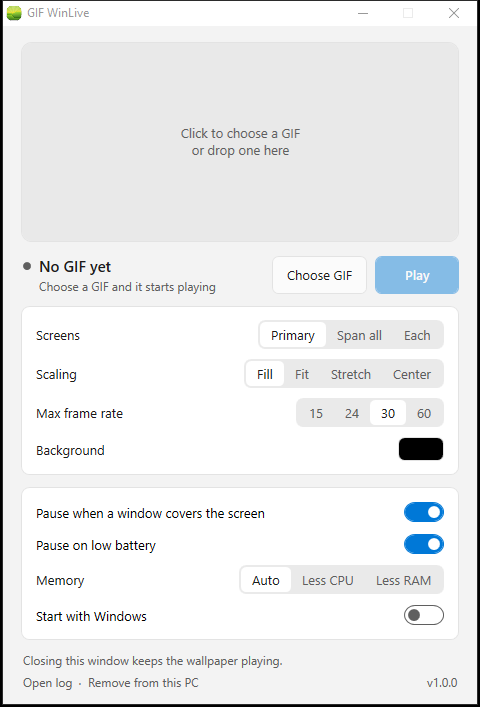

# GIF WinLive

**Any animated GIF as your Windows wallpaper, behind your desktop icons, so light you won't notice it's running.**

One small `.exe`. No installer, no admin rights, no internet access. Works on Windows 10 (21H2 or newer) and Windows 11.



## Use it

1. Download **`GifWinLive.exe`** from [Releases](../../releases) and put it anywhere (Desktop, Documents, a USB stick…).
2. Double-click it and **pick a GIF**. It starts playing behind your icons right away.
3. Say **Yes** if you want it back after a restart.

To change anything later, just open `GifWinLive.exe` again. Closing the window keeps the wallpaper playing.

> **"Windows protected your PC"?** SmartScreen shows this for any new app that isn't signed by
> a big publisher. Click **More info → Run anyway**, or build it yourself from source (below).

## What it does

- 🖼️ Plays **behind your desktop icons**, not in a window on top of them
- 🎨 Clean control panel that follows your **light/dark theme and accent colour**, with drag-and-drop
- 🖥️ **Multi-monitor**: primary screen, one GIF across all screens, or the same GIF on each
- ⏸️ **Pauses itself** when a game, video or maximized app covers the screen, when the PC is locked,
  and on low battery (20 % or Battery saver)
- 🔁 Survives Explorer restarts and resolution changes
- 🧳 **Portable**: settings live in a hidden file next to the exe. Copy the exe to another PC and it just works.

## Light on your PC

The wallpaper runs inside the same tiny exe, with no PowerShell, service or helper processes.
**Memory: Auto** picks the lightest option for each GIF:

| Sample GIF (1080p screen) | Task Manager memory | CPU (one core) |
|---|---|---|
| 1280×720, 36 frames | **30 MB** | ~1–2 % |
| 1366×768, 24 frames | **31 MB** | ~1 % |
| 1920×1080, 6 frames | 59 MB | **0 %** |
| 1920×1080, 60 frames | 53 MB | ~3–4 % |

*Measured with pausing turned off. In normal use it pauses (0 % CPU) whenever the desktop is covered.*

- **Auto**: GIFs with few frames stay ready on the GPU (no CPU). GIFs with many frames are decoded
  while playing (very little RAM).
- **Less CPU**: always keeps frames on the GPU. Near-zero CPU, but more memory for long GIFs.
- **Less RAM**: always decodes while playing.

It also runs at low priority in Windows' efficiency mode, frees memory when you close the panel,
and only writes a log file if something goes wrong.

## Your PC stays clean

| What | Where |
|---|---|
| Settings | `GifWinLive.json`, a hidden file next to the exe (or `%APPDATA%\GifWinLive` if that folder is read-only) |
| Problem log | `GifWinLive.log`, hidden, created only if something goes wrong |
| Start with Windows | one value under `HKCU\Software\Microsoft\Windows\CurrentVersion\Run`, only if you turn it on |

**Remove from this PC** (bottom of the panel) deletes all of that. Then delete the exe and it's gone.

## Command line

```
GifWinLive.exe               open the panel (and play the saved GIF)
GifWinLive.exe --background  play without the panel (used at sign-in)
GifWinLive.exe --stop        stop it
```

## Build it yourself

No Visual Studio or SDK needed. Windows already includes the C# compiler.

```
build.cmd
```

This produces `GifWinLive.exe` from the files in `src\`:

| File | |
|---|---|
| `App.cs` | entry point, settings, single instance, Start with Windows |
| `Engine.cs` | decodes the GIF and plays it in the desktop layer |
| `Panel.cs` | the control panel |
| `Native.cs` | Win32 calls and desktop-layer discovery |
| `app.manifest`, `app.ico` | DPI awareness, no admin prompt, icon |

## How it works

1. Explorer is asked (message `0x052C`) to create the desktop layer between the static wallpaper and
   the icons. Windows 10 and 11 are handled, including the newer 24H2 layout (please report problems there).
2. A borderless window is placed inside that layer, so icons, the taskbar and all apps stay on top.
3. GDI+ decodes and composites the frames. WPF draws them on the GPU on a timer that follows each
   frame's own delay, capped by **Max frame rate**.

## Troubleshooting

- **Nothing appears / "Waiting for the desktop".** It retries by itself. If it never shows, restart
  Windows Explorer in Task Manager.
- **The GIF covers the icons or is invisible.** Set `"UseChildStyle": false` in the settings file
  (show hidden files to see it), then press Stop and Play. Please [open an issue](../../issues)
  with your Windows version.
- **Remote Desktop / VM without a GPU.** Rendering falls back to the CPU. Choose a lower frame rate.

Requires Windows 10 21H2 or newer, or Windows 11. It uses the .NET Framework 4.8 that comes with Windows, so there is nothing else to install.

## License

[MIT](LICENSE)
